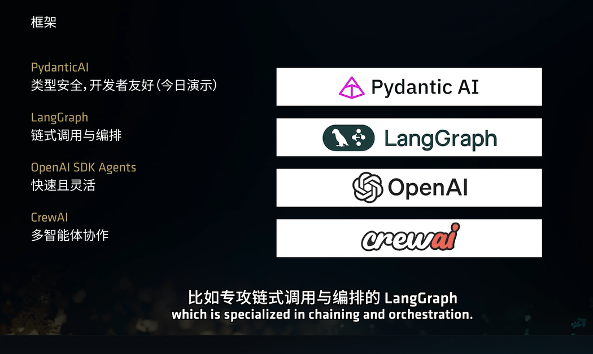
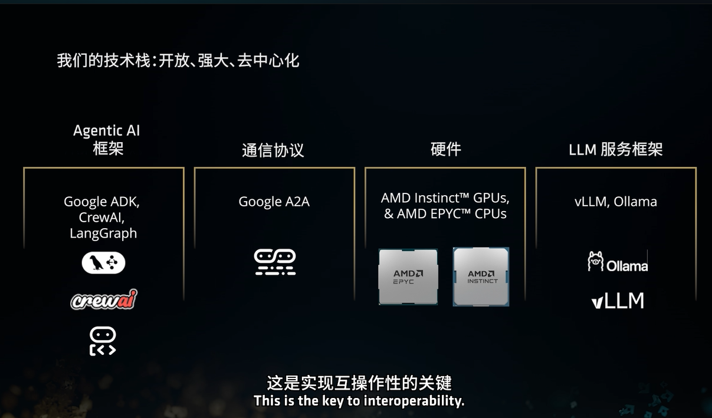
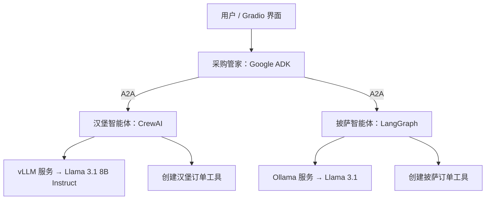
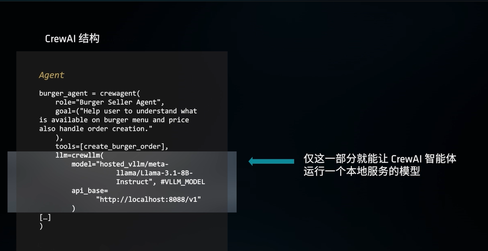
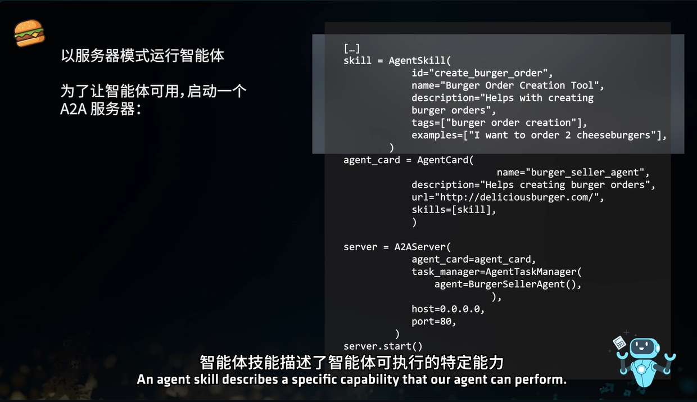
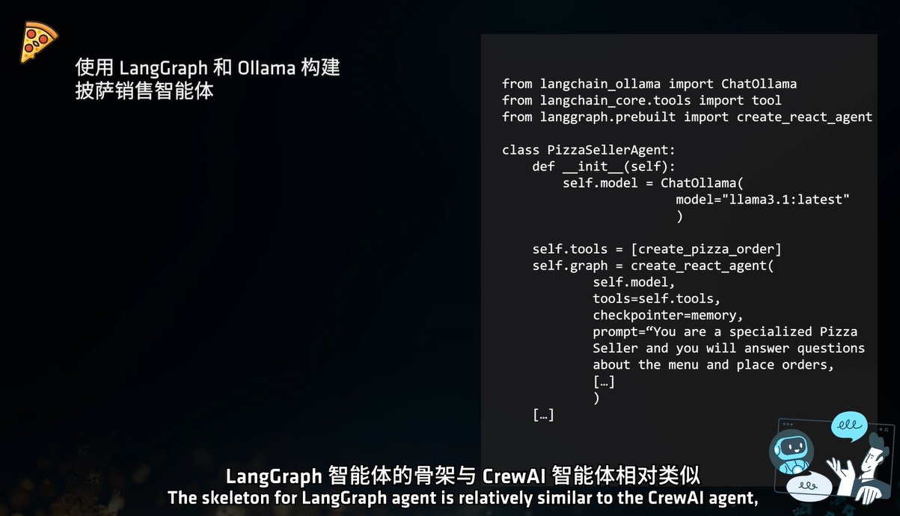
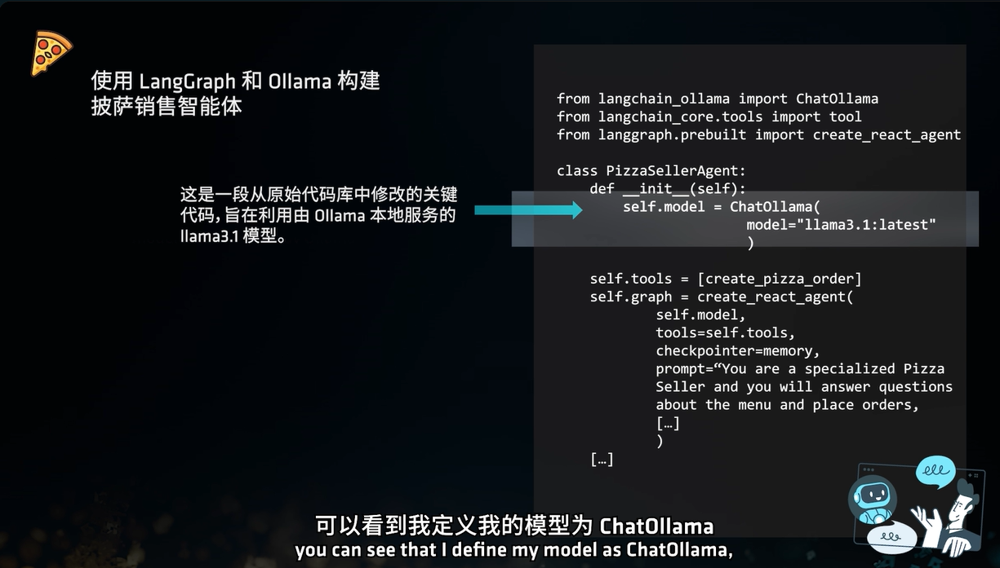
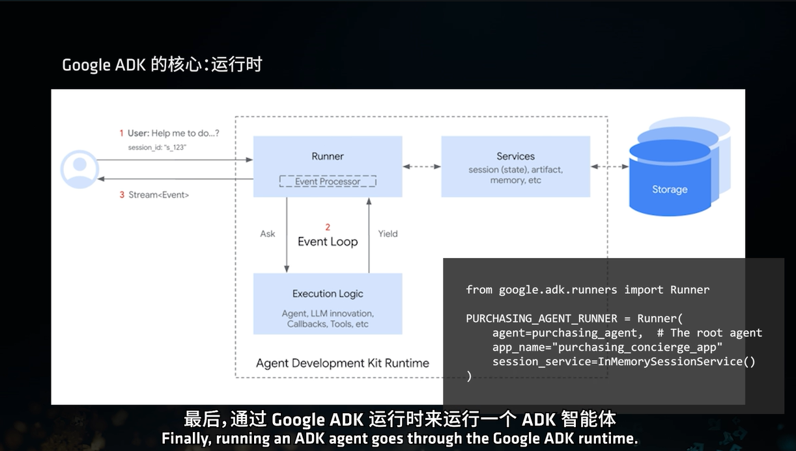

# 多智能体协作：ADK、A2A、CrewAI 与 LangGraph

> AMD AI 学院视频课学习笔记。以采购管家协调汉堡、披萨销售智能体为例，理解智能体框架、通信协议与本地模型服务如何配合。
>
> 本文依据课程文字、截图及官方文档整理。截图代码为课程版本片段，不是可直接执行的完整项目；实际依赖与 API 以课程仓库为准。以下内容不代表已经完成实操验证。

## 1. 技术栈：先区分四个层次



课程展示了 PydanticAI、LangGraph、OpenAI Agents SDK、CrewAI 等智能体框架。它们用于组织模型、工具和执行流程；A2A 解决独立智能体之间的通信。

| 层次 | 课程涉及的技术 | 职责 |
| --- | --- | --- |
| 智能体框架 | Google ADK、CrewAI、LangGraph | 组织角色、任务、工具调用和工作流程 |
| 智能体通信 | A2A（Agent2Agent） | 发现其他智能体，交换消息、任务和结果 |
| 模型服务 | vLLM、Ollama | 加载模型权重并提供推理 API |
| 硬件与计算环境 | AMD Instinct GPU、EPYC CPU、ROCm 等 | 执行模型计算及应用逻辑 |



**Llama 是模型；vLLM 和 Ollama 运行模型；CrewAI 等框架利用模型构建智能体；A2A 让智能体之间协作。**

### 1.1 基本概念

- **AI 智能体（Agent）**：接收输入，结合模型、工具和状态，采取行动以完成目标的程序。
- **智能体名片（Agent Card）**：描述智能体身份、技能、访问方式等信息的 JSON 元数据文档，是智能体发现机制的基础。
- **A2A 协议**：独立智能体通信与协作的开放标准，使不同框架构建的智能体能够互操作。[官方定义](https://a2a-protocol.org/dev/specification/agent-card/)

Google ADK 是开发框架，A2A 是由 Google 发起的通信协议项目，不能理解为“ADK 开发了 A2A”。参与协作的智能体不必采用同一个框架。

## 2. 课程案例：采购管家与销售智能体

用户先与采购管家（Root Agent）交互，再由管家协调不同技术栈的销售智能体。



例如，用户要求“两个芝士汉堡和一个披萨”：采购管家协调两个销售智能体，各自处理菜单、规格和订单信息，再返回结果。这里是案例的职责划分，不代表仅凭截图片段就已实现全部流程。

### 2.1 自托管技术栈的意义

- **数据控制**：可让推理在自己的环境中完成，但是否外发数据仍取决于外部工具、日志、遥测和部署配置，不能直接称为“绝对隐私”。
- **深度定制**：可以调整模型、提示词及工具，必要时对模型微调。
- **成本与性能优化**：根据模型大小、并发及硬件选择方案；自托管仍有硬件与运维成本。

## 3. 汉堡智能体：CrewAI + vLLM

### 3.1 CrewAI 定义角色、目标和工具



| 配置 | 作用 |
| --- | --- |
| `role` | 设定角色：汉堡销售员 |
| `goal` | 设定目标：回答菜单、价格问题并处理订单 |
| `tools=[create_burger_order]` | 提供实际创建订单的业务工具 |
| `llm` | 配置智能体使用的模型客户端 |

模型负责理解请求、生成回答或提出工具调用；订单工具负责执行实际业务。模型回答“下单成功”不代表订单已写入系统，必须核对工具执行结果。

### 3.2 模型标识不等于文件目录

课程配置片段：

```python
model="hosted_vllm/meta-llama/Llama-3.1-8B-Instruct"
api_base="http://localhost:8088/v1"
```

| 部分 | 含义 |
| --- | --- |
| `hosted_vllm/` | LiteLLM 的 vLLM 提供方前缀 |
| `meta-llama/Llama-3.1-8B-Instruct` | 服务端提供的模型名，通常沿用 Hugging Face 仓库 ID |
| `http://localhost:8088/v1` | 模型服务 API 地址 |

不需要创建名为 `hosted_vllm` 的模型文件夹。模型文件由 vLLM 服务端加载，CrewAI 通过 HTTP 调用服务。[vLLM 与 LiteLLM 集成说明](https://docs.vllm.ai/en/latest/deployment/frameworks/litellm/)

### 3.3 先启动模型服务，再连接智能体

如果课程已经启动模型服务，直接连接即可。自行部署时，可参考以下示意命令：

```bash
# 替换为实际模型目录；需要兼容当前 GPU 的 vLLM 环境。
vllm serve /workspace/models/llama31-8b \
  --served-model-name meta-llama/Llama-3.1-8B-Instruct \
  --port 8088 \
  --max-model-len 8192
```

`--served-model-name` 指定 API 对外提供的模型名，应与客户端去掉 `hosted_vllm/` 后的名称一致。这里限制上下文为 8192 作为学习示例，不是模型的最大上下文。[vLLM 参数说明](https://docs.vllm.ai/en/latest/cli/serve/)

在另一个终端查看服务提供的模型：

```bash
curl http://localhost:8088/v1/models
```

`localhost` 指客户端所在的机器或容器。跨机器、隔离容器部署时应使用可达的服务地址。返回模型列表后，仍需验证实际推理与工具调用。

### 3.4 使用 A2A 对外提供汉堡智能体服务



截图中的三个对象分别负责能力描述、名片描述和网络服务。

#### 3.4.1 AgentSkill：描述“我会做什么”

| 字段 | 作用 |
| --- | --- |
| `id` | 技能唯一标识，如 `create_burger_order` |
| `name` | 人类可读的技能名称 |
| `description` | 描述技能用途 |
| `tags` | 分类、检索用关键词 |
| `examples` | 典型请求，例如“我要两个芝士汉堡” |

**技能声明没有实现下单逻辑。** 即使 `id` 与工具函数同名，也不会自动绑定该工具。实际能力由智能体与业务工具实现。[A2A 技能定义](https://a2a-protocol.org/dev/specification/agent-card/)

#### 3.4.2 AgentCard：说明“我是谁、在哪里访问”

名片汇总智能体身份与访问要求。课程使用 `skills=[skill]` 将技能加入名片，通过 `url` 声明服务地址。调用方据此判断是否适合把任务交给该智能体；声明地址应与实际部署一致。

#### 3.4.3 A2AServer：启动对外接单服务

按截图结构，`BurgerSellerAgent()` 是实际智能体，`AgentTaskManager(...)` 衔接外部任务与执行逻辑，`server.start()` 启动网络服务。任务状态管理的具体行为取决于课程实现。

- `host="0.0.0.0"`：监听所有本机 IPv4 网络接口；客户端应访问真实主机地址。
- `port=80`：课程中 A2A 服务的端口。
- `8088`：前面 vLLM 模型服务的端口，两者处理不同层次的请求。

```text
其他智能体 → A2A 服务（80）→ 汉堡智能体
                              ├─ 订单工具
                              └─ vLLM（8088）→ Llama
```

> 截图中的 `A2AServer`、`AgentTaskManager` 和名片字段可能来自早期 SDK 或课程封装。截图还将 `0.0.0.0` 写成未加引号的形式，不能直接作为有效 Python 代码复制运行。

## 4. 披萨智能体：LangGraph + Ollama

### 4.1 LangGraph 组织模型与工具的执行流程



| 代码元素 | 作用 |
| --- | --- |
| `ChatOllama(...)` | 连接 Ollama 服务的模型客户端 |
| `create_pizza_order` | 实际创建披萨订单的工具 |
| `create_react_agent(...)` | 课程使用的 ReAct 智能体构建入口，组织模型与工具调用循环 |
| `prompt` | 设定披萨销售员的角色与任务边界 |
| `checkpointer=memory` | 保存图执行状态；是否持久化取决于具体实现 |

此处 ReAct 可理解为：模型选择行动，工具执行后返回结果，模型再决定继续调用还是回答。`checkpointer` 不等于长期知识库；线程内检查点与跨线程长期存储是不同概念。[LangGraph 官方存储说明](https://github.com/langchain-ai/docs/blob/main/src/oss/langgraph/stores.mdx)

### 4.2 Ollama 管理和运行本地模型



```python
from langchain_ollama import ChatOllama

model = ChatOllama(
    model="llama3.1:8b",
    base_url="http://localhost:11434",
)
```

安装 Ollama 不等于下载了 Llama 3.1。可以按以下顺序准备模型：

```bash
# 如 Ollama 服务尚未运行，在单独终端启动；已运行时不要重复启动。
ollama serve

# 在另一个终端下载模型、查看本地列表。
ollama pull llama3.1:8b
ollama list

# 可选：进入命令行对话，验证生成是否正常。
ollama run llama3.1:8b
```

`ollama run` 在模型不存在时会先拉取模型；`ChatOllama(...)` 本身只是客户端配置，不代表执行下载。课程使用的 `llama3.1:latest` 当前对应默认 8B 模型，显式写 `:8b` 更便于理解；严格复现还需记录模型摘要和量化版本。[模型标签](https://ollama.com/library/llama3.1/tags)、[Ollama 快速入门](https://github.com/ollama/ollama/blob/main/docs/quickstart.mdx)

## 5. Google ADK：会话、状态、记忆和运行时

### 5.1 Session、State、Memory 的区别

| 概念 | 含义 | 案例中的例子 |
| --- | --- | --- |
| Session（会话） | 一条对话线程，包含事件历史和状态 | 本次采购对话 |
| State（状态） | 执行过程中读写的键值信息 | 待确认数量、订单进度 |
| Memory（记忆） | 可供后续交互检索、复用的信息 | 明确保存的长期口味偏好 |

状态的作用域取决于配置：ADK 除会话状态外还提供用户、应用、临时等作用域机制。长期记忆需要配置相应服务与写入、检索流程，并非自动永久记录所有对话。[ADK 会话说明](https://github.com/google/adk-docs/blob/main/docs/sessions/session/index.md)、[状态说明](https://github.com/google/adk-docs/blob/main/docs/sessions/state.md)

### 5.2 Runner 驱动执行



图中 Runner 负责协调执行：接收输入、取得会话上下文、驱动智能体逻辑，并通过事件流返回执行过程与结果。会话、状态、记忆及产物则交给对应服务管理。

课程将采购管家传入 `Runner`，使用 `InMemorySessionService()` 管理会话。内存服务适合演示，进程退出后不能据此假设会话仍然保存。

## 6. Gradio 交互演示与验证顺序

Gradio 承担用户界面：提交输入、展示应用返回的消息。智能体编排、A2A 通信和模型推理分别由前面的组件完成。

当前素材没有独立的 Gradio 界面截图；原先放在此处的图片实际是 ADK 运行时，已调整到上一节。

建议按依赖顺序验证：

1. **模型服务**：vLLM / Ollama 可达，目标模型能够生成回答。
2. **单个销售智能体**：菜单问答正确，订单工具能执行并返回真实结果。
3. **A2A 服务**：名片可读取，声明地址可达，任务与结果能够往返。
4. **采购管家**：能够协调两个销售智能体，维护本次采购状态。
5. **Gradio 界面**：用户输入能到达运行时，结果能正确展示。

## 7. 复习要点

- AgentSkill 描述能力，工具函数执行实际业务。
- AgentCard 帮助发现智能体，A2A 服务接收协作请求。
- vLLM / Ollama 托管模型，智能体框架通过客户端调用它们。
- 模型名称、模型文件目录和 API 地址需要分别配置。
- Session、State、Memory 与 checkpointer 的含义和持久化边界需要分别确认。
- 课程截图用于理解结构；复现时需核对框架版本、GPU 支持和模型配置。
