# 大语言模型（LLM）基础与优化

- 视频学习：1.1–1.4 共 4/4 节均已完成；课后补充学习与实践事项见下文。
- Notebook 实践：尚未开始。
- 课程链接：[大语言模型（LLM）基础与优化](https://developer.amd.com.cn/academy/learningPaths/40ef5f58-303e-4b54-bc39-d64cfd9d2235)。

## 1. 理论学习（视频已完成，延伸学习待补充）

### 1.1 量化入门：动机与优势

> 视频已学习；以下根据现有文字与课程截图整理。课程列出但未展开的内容保留为“待补充学习”。

#### （1）为什么需要量化？

**量化**是减少表示模型权重、激活值等数值所需比特数的过程，例如将 FP32 权重映射为 INT8 表示。

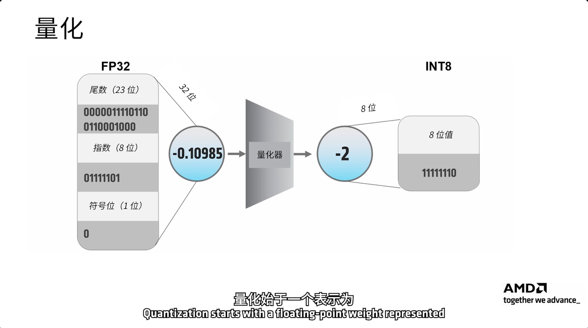

量化的主要动机是降低模型的存储、内存和计算成本，支持资源受限的边缘设备部署。整理量化方案时，需要关注以下维度：

| 维度 | 课程提及的内容 |
| --- | --- |
| 量化目标 | 权重：保存在模型文件中；激活值：模型运行时产生的中间值 |
| 数据类型 | FP32、FP16、INT8 等不同精度的表示 |
| 量化时机 | 训练后量化（PTQ）；量化感知训练（QAT） |
| 相关工具与生态 | Quark、Olive、ONNX、Brevitas；具体用途与搭配待实践确认 |

#### （2）量化方程：直观理解与收益

**直观理解：将较精细的浮点数值映射到有限的离散数值上，以较低精度换取资源节省。** 截图中的浮点数与整数是映射前后的表示，不能理解为二者数值相等；具体映射规则留待后续补充。

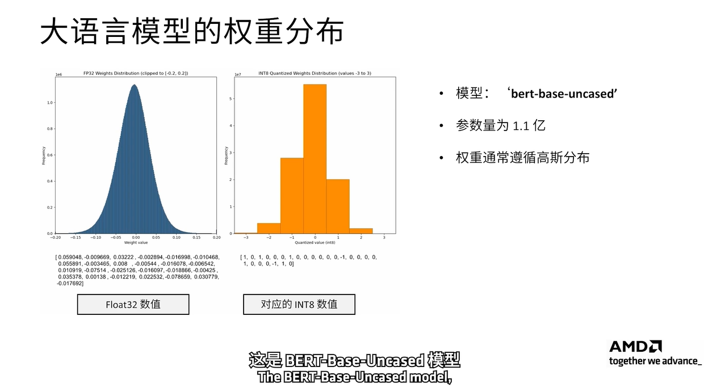

课程以约 1.1 亿参数的 `bert-base-uncased` 为例，展示权重集中在零附近的分布，以及量化后离散整数的分布。该图用于直观比较，不代表所有模型权重都严格服从高斯分布。

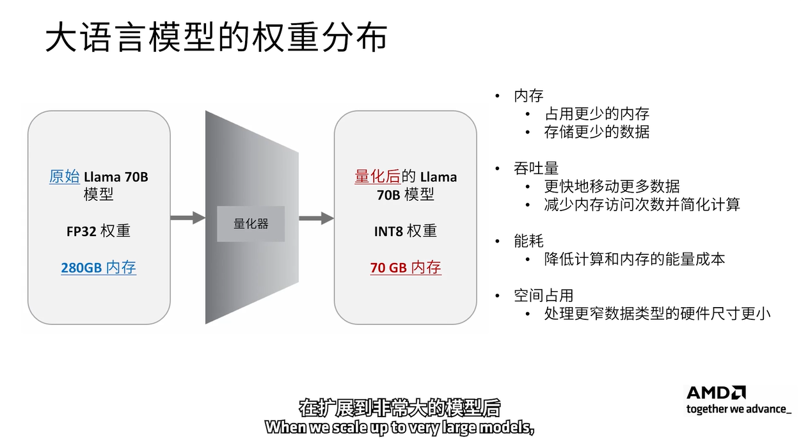

以课程中的 **Llama 70B** 为例，仅按参数数量和每个参数的字节数估算：

| 权重表示 | 每个参数占用 | 约 700 亿参数的权重存储量 |
| --- | --- | --- |
| FP32 | 4 字节 | 280 GB |
| INT8 | 1 字节 | 70 GB |

上述估算采用十进制 GB，INT8 权重存储量约为 FP32 的 **1/4**；不包含量化元数据、激活值、KV Cache 等运行开销，因此不等于实际推理所需的总显存。

课程归纳的潜在收益包括：

- **内存与存储**：减少权重存储量和内存占用。
- **吞吐量**：减少数据搬运量与内存访问压力，并利用低精度计算。
- **能耗**：降低计算和内存访问的能源成本。
- **硬件面积**：低精度运算单元有机会采用更小的硬件实现。

实际速度和精度变化仍需结合硬件、算子支持及具体量化方案验证。

#### （3）映射方案与校准

**待补充学习**：课程列出但未展开，课后结合实践补充。

#### （4）优化：量化粒度

**待补充学习**：课程列出但未展开，课后结合实践补充。

#### （5）量化算法

**待补充学习**：课程列出但未展开，课后结合实践补充。

### 1.2 RAG 入门：RAG 简介

> 视频已学习；以下根据现有文字与课程截图整理。

#### （1）RAG 的定义与动机

**RAG（Retrieval-Augmented Generation，检索增强生成）**将信息检索与语言模型生成结合：先查找与问题相关的文档，再让模型依据检索结果回答。

传统 LLM 可能出现错误信息、知识过时、来源不够权威或术语混淆。RAG 通过引入内部专有数据或外部可信资料，为特定领域的回答提供上下文依据，有助于提高准确性、减少幻觉；效果仍取决于资料质量和检索结果。

#### （2）基础架构与工作流程

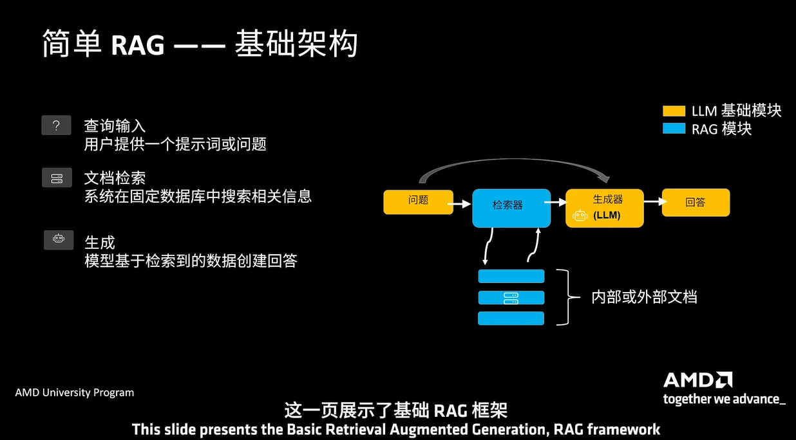

1. **查询输入**：用户提供问题或提示词。
2. **文档检索**：检索器从内部或外部文档库中查找相关信息。
3. **生成回答**：将原问题与检索到的上下文一起提供给 LLM，生成回答。

#### （3）核心组件

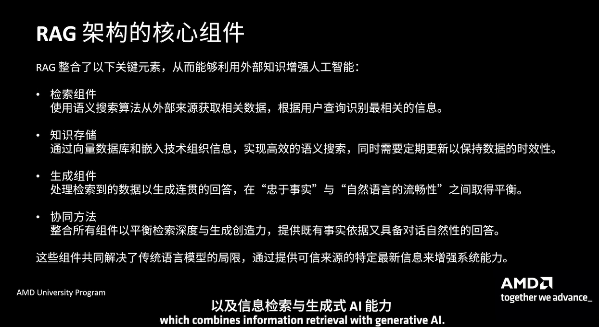

| 组件 | 作用 |
| --- | --- |
| 检索组件 | 利用语义搜索等方法，根据用户查询寻找相关信息 |
| 知识存储 | 利用嵌入与向量数据库等方式组织信息，并定期更新以保持时效性 |
| 生成组件 | 基于检索结果组织连贯的回答，兼顾事实依据与语言流畅性 |
| 协同方法 | 整合检索与生成环节，平衡检索深度与回答自然度 |

#### （4）基础 RAG 的挑战与高级方向

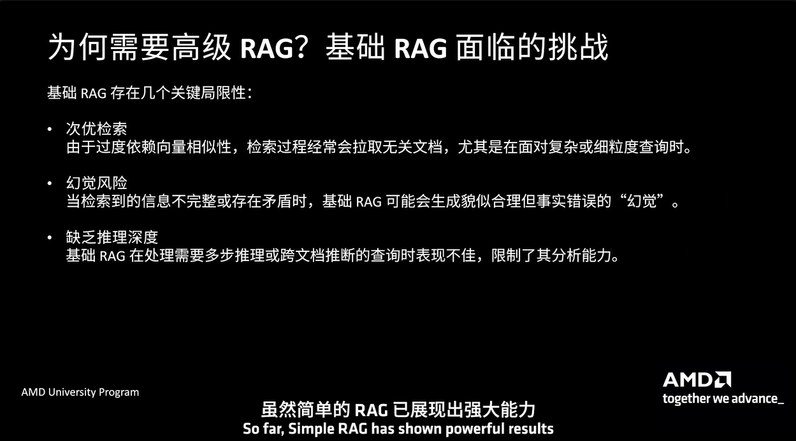

| 挑战 | 具体表现 |
| --- | --- |
| 次优检索 | 过度依赖向量相似度时，可能召回无关文档，复杂或细粒度查询尤其明显 |
| 幻觉风险 | 检索信息不完整或相互矛盾时，仍可能生成看似合理但事实错误的回答 |
| 推理深度不足 | 对需要多步推理或跨文档推断的问题，基础流程可能表现不佳 |

课程提及的高级方向包括**多向量检索、混合搜索、递归检索**。具体机制、适用场景与效果对比：**待补充学习**，课后结合实践验证。

#### （5）参考资料与延伸学习

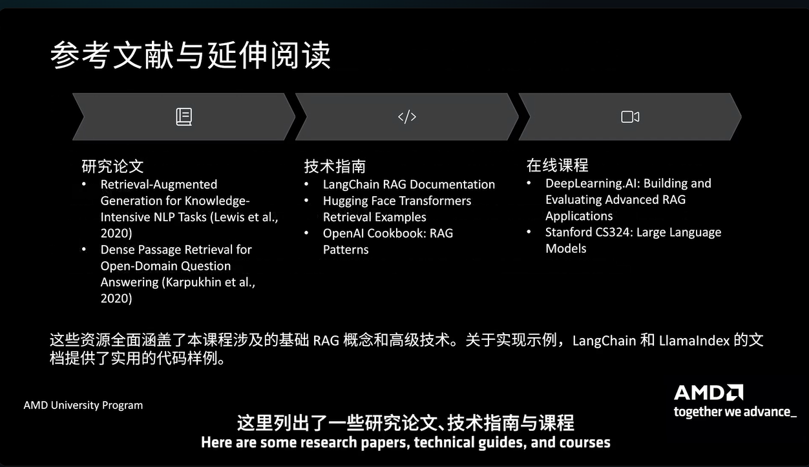

以下按截图记录资料名称，尚未核实具体链接，也不代表已完成阅读。

| 类型 | 课程列出的资料 |
| --- | --- |
| 研究论文 | *Retrieval-Augmented Generation for Knowledge-Intensive NLP Tasks*（Lewis et al., 2020）；*Dense Passage Retrieval for Open-Domain Question Answering*（Karpukhin et al., 2020） |
| 技术指南 | LangChain RAG Documentation；Hugging Face Transformers Retrieval Examples；OpenAI Cookbook: RAG Patterns |
| 在线课程 | DeepLearning.AI: Building and Evaluating Advanced RAG Applications；Stanford CS324: Large Language Models |
| 实现参考 | LangChain、LlamaIndex 文档中的代码示例 |

**待补充学习**：按实践需要选择资料阅读，补充可访问链接及实现记录。

### 1.3 提示词工程入门：提示词技术基础

> 视频已学习；以下根据现有文字与课程截图整理。仅提及但缺少详细记录的内容保留为“待补充学习”。

#### （1）提示词工程的定义与基本要素

**提示词工程**是通过设计和优化问题、指令及背景信息，引导 AI 生成符合任务目标的回答。它不需要重新训练模型或修改模型权重，可用于问答、内容生成和算术推理等任务。

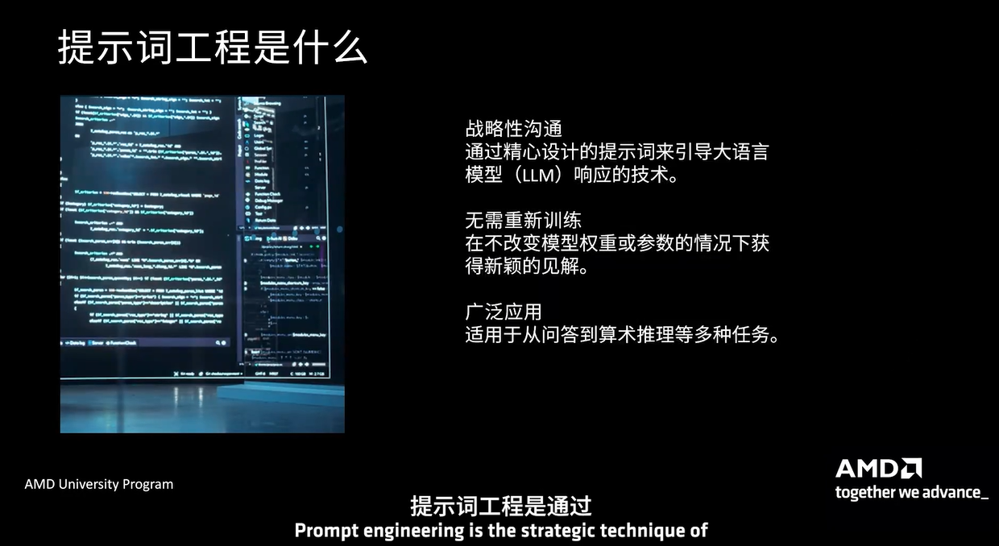

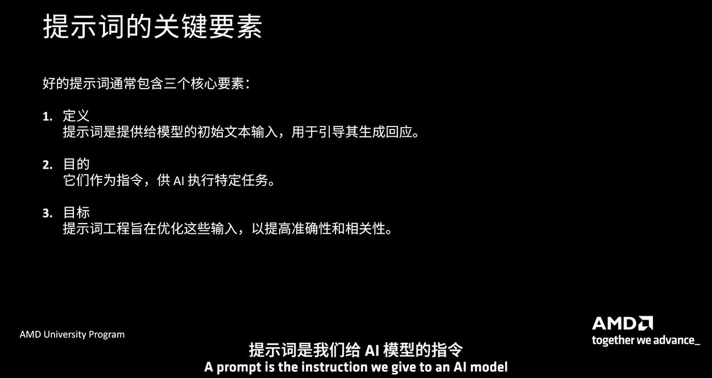

| 方面 | 课程要点 |
| --- | --- |
| 定义 | 提示词是提供给模型的初始文本输入，用于引导其生成回应 |
| 目的 | 通过指令让模型执行特定任务 |
| 优化目标 | 提高回答的准确性、相关性与任务适配程度 |

除了任务指令，还可以通过以下信息明确预期：

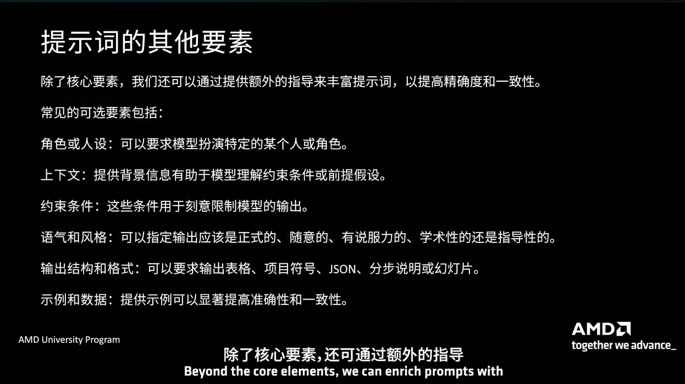

| 可选要素 | 作用 |
| --- | --- |
| 角色或人设 | 指定模型扮演的身份或角色 |
| 上下文 | 提供背景信息、前提假设和任务细节 |
| 约束条件 | 限制输出范围或明确必须遵守的要求 |
| 语气和风格 | 指定正式、随意、学术或指导性等表达方式 |
| 输出结构和格式 | 指定表格、项目符号、JSON 等形式 |
| 示例和数据 | 展示期望的输入输出模式，帮助保持一致性 |

#### （2）生成设置：Temperature、Top-K 与 Top-P

这些设置控制生成时的采样行为，与提示词文本共同影响输出。

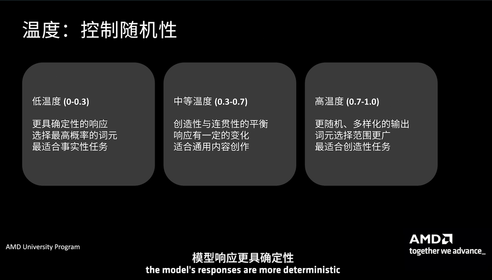

| 设置 | 直观理解 | 调整方向 |
| --- | --- | --- |
| Temperature（温度） | 调整词元概率分布的集中程度 | 较低时更偏向高概率词元；较高时通常更随机、多样 |
| Top-K | 仅从概率排名前 K 的词元中采样 | K 较小会缩小候选范围；K 较大会扩大候选范围 |
| Top-P（核采样） | 按概率从高到低累加，保留累计概率达到阈值 P 的最小候选集合 | 候选数量随当前概率分布变化；P 较大通常保留更多候选 |

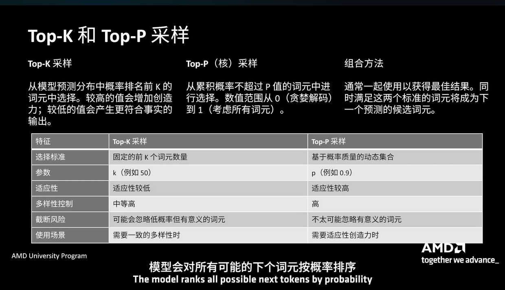

课程以 `0–0.3`、`0.3–0.7`、`0.7–1.0` 示意低、中、高温度，分别对应较稳定的输出、兼顾变化与连贯性、更多样的输出。这是课程的直观分档，不代表所有模型的固定取值范围或最佳配置。

> 整理注：截图中 Top-P 的“累计概率不超过 P”表述不够准确，上表采用“累计概率达到阈值”的描述。低温度或较小的采样范围不保证事实正确；是否同时使用 Top-K 与 Top-P，应结合实际推理接口和任务验证。

#### （3）基础技巧：零样本、单样本与少样本

| 技巧 | 提示方式 |
| --- | --- |
| 零样本（Zero-shot） | 直接描述任务，不提供输入输出示例 |
| 单样本（One-shot） | 提供一个输入输出示例，再给出新任务 |
| 少样本（Few-shot） | 提供多个输入输出示例，让模型参考共同模式处理新输入 |

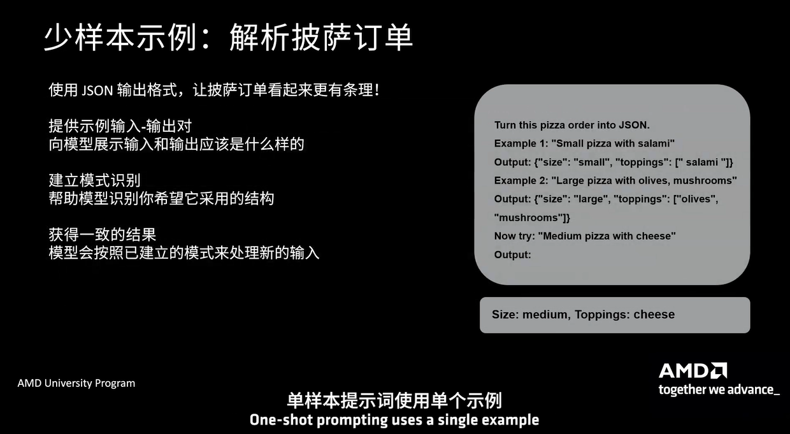

课程使用“将披萨订单转成 JSON”的例子：先给出 small、large 两组订单和对应输出，再让模型处理新的 medium 订单。示例用于说明字段与结构，而不是重新训练模型。

按截图中的字段整理，新订单 `Medium pizza with cheese` 的目标格式可以写为：

```json
{"size": "medium", "toppings": ["cheese"]}
```

以上是整理后的格式示例，未实际运行验证。截图底部的 `Size: medium, Toppings: cheese` 并非合法 JSON；如果任务要求 JSON，仍需检查实际输出格式。

#### （4）系统提示词、上下文提示词与角色提示词

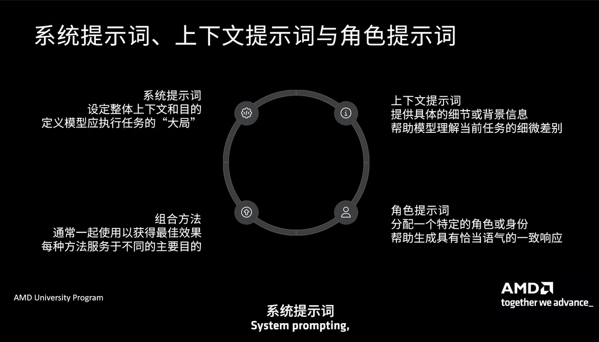

| 类型 | 作用 |
| --- | --- |
| 系统提示词 | 设置整体上下文、目的和模型执行任务的总体要求 |
| 上下文提示词 | 提供当前任务的具体细节和背景信息 |
| 角色提示词 | 分配特定身份，帮助保持恰当的语气与一致的表达 |

这些方式可以组合使用，分别明确总体要求、当前任务背景和表达身份。

#### （5）技巧演变与进阶方向

**后退提示词（Step-back Prompting）**：先处理更一般的问题，梳理相关背景知识和原则，再将这些内容用于具体任务。

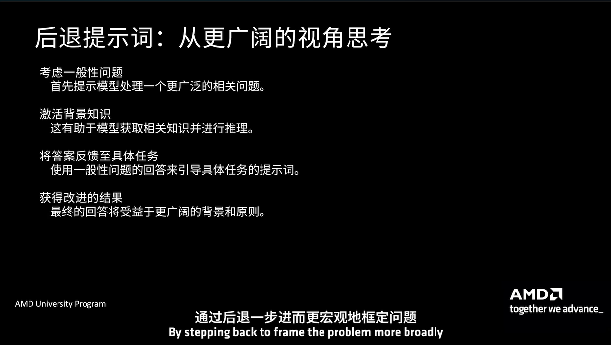

课程截图展示的流程为：

1. 提出一个更广泛、与原任务相关的一般性问题。
2. 梳理相关背景知识与原则。
3. 将一般性问题的回答作为具体任务的上下文。
4. 检查最终回答是否受益于这些背景与原则。

其他原始笔记提及的方向：

- **思维链（Chain-of-Thought）**：待补充学习，补齐课程示例与适用场景。
- **推理与行动提示**：待补充学习，补齐方法名称、流程及示例。
- **术语待核对**：原始记录中的“演变”“四位数”缺少足够上下文，暂不据此推断具体技术名称。

#### （6）最佳实践

**待补充学习**：原始笔记保留了此标题，但没有具体内容；课后结合课程回看或实践补充。

### 1.4 LLM 架构与 AMD AI 模型入门：大语言模型

> 视频已学习；以下根据现有文字与课程截图整理。“基础模型与 Chat / Instruct”的解释为课后补充，来源单独列出。

#### （1）LLM 的基本能力

LLM 通过大规模文本学习语言模式及上下文关系，可用于文本分类、问答、信息检索等任务。

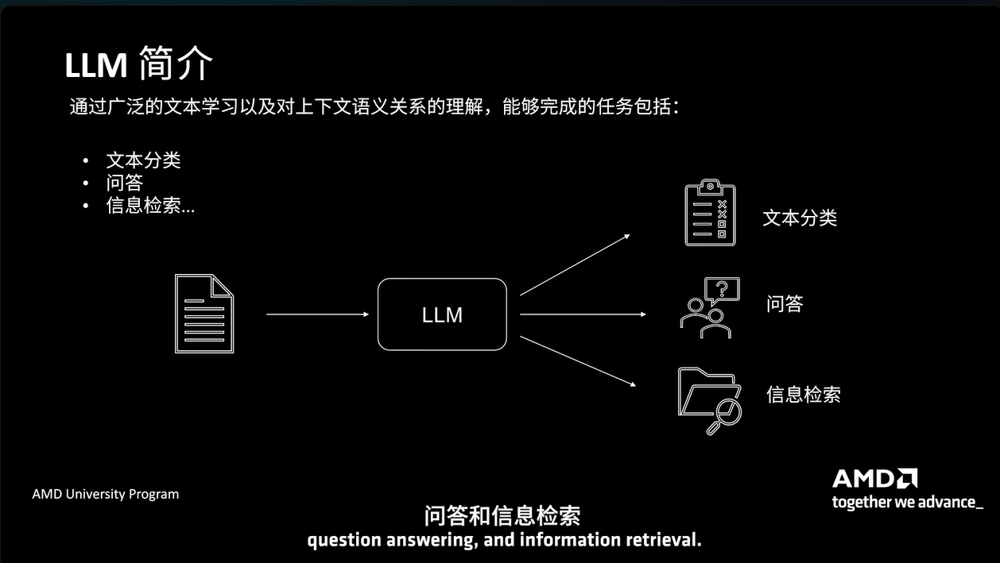

| 任务 | 作用 |
| --- | --- |
| 文本分类 | 根据输入内容判断类别 |
| 问答 | 根据问题和可用上下文组织回答 |
| 信息检索 | 参与查询理解、相关信息筛选等流程；具体能力取决于模型与系统设计 |

**待补充学习**：现有记录未包含具体网络架构、注意力机制或 AMD 模型清单，后续结合课程材料补齐。

#### （2）如何提升 LLM 的任务表现？

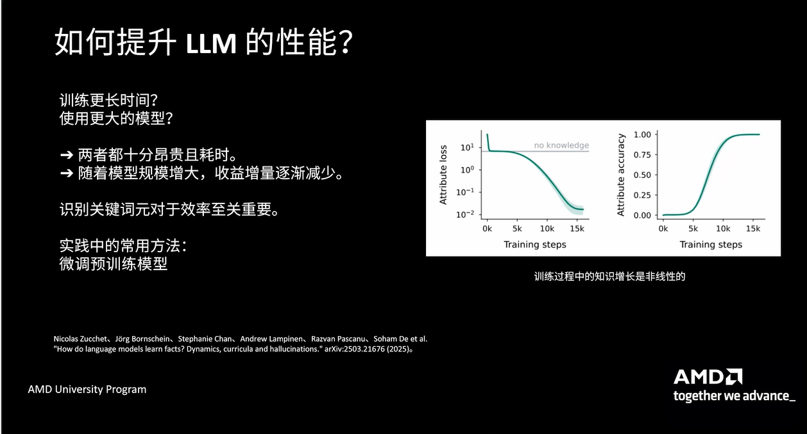

课程指出，使用更大的模型或训练更长时间都需要较多时间与计算资源，规模增加带来的收益也可能递减。截图中的曲线用于说明训练过程中的知识习得可能是非线性的，不能据此推出所有模型都有相同的学习曲线。

在已有预训练模型的基础上进行**微调**，是使其适应具体任务的常用方法。课程还提到关键词元对效率的重要性，具体方法与实验依据：**待补充学习**。

#### （3）什么是微调？

**微调（Fine-tuning）**是在预训练模型的基础上，使用有针对性的数据继续训练，使其更适合特定任务或场景。

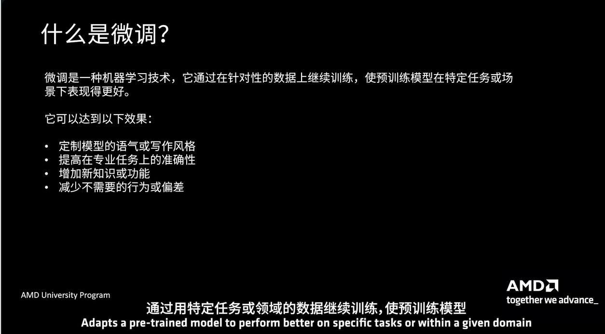

| 用途 | 课程中的说明 |
| --- | --- |
| 定制表达 | 调整语气或写作风格 |
| 适配任务 | 提高特定专业任务上的表现 |
| 学习新知识或功能 | 通过针对性训练增强相关能力，效果需要评估 |
| 调整行为 | 减少不需要的行为或偏差，不代表能完全消除 |

微调会更新模型的全部或部分可训练参数；这与 1.3 中通过修改输入引导输出的提示词工程不同。相对于从头预训练，微调通常使用更少的任务数据，但数据质量、训练成本和效果仍需验证。

#### （4）微调效果：如何阅读课程中的对比表？

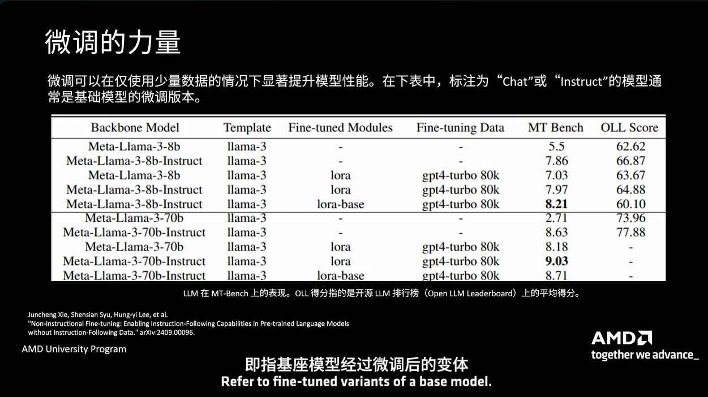

截图列出了 Llama 3 的 8B、70B 基础模型、Instruct 版本，以及在这些模型上进一步使用 LoRA 等配置训练的结果。

- **Backbone Model**：本次实验所用的起始模型，可能是基础模型，也可能是已经过指令微调的模型。
- **Fine-tuned Modules / Fine-tuning Data**：本次实验进一步微调所用的配置与数据。
- **MT Bench / OLL Score**：不同评测指标；截图说明 OLL 为 Open LLM Leaderboard 的平均得分。

以截图中的 8B 模型为例，基础版本的 MT-Bench 为 **5.5**，Instruct 版本为 **7.86**。进一步微调后，有的指标上升、有的下降，因此不能把“微调有效”理解为所有能力都会同步提升。这些是课程引用实验中的结果，不是本地实测。

> 表中 `-` 表示该行没有列出本次实验的额外微调配置，不能据此认为 Instruct 模型从未经过微调。

#### （5）为什么 Chat / Instruct 通常是基础模型的微调版本？

**基础模型先通过预训练学习语言和知识，再通过面向指令或对话的训练，学习如何作为助手回应用户。** `Chat`、`Instruct` 通常表示后一个阶段训练得到的版本，而不只是给基础模型换了名字或增加一段提示词。

```text
大规模文本 → 预训练 → 基础模型（Base）
                         ↓
              指令与回答、对话等数据
                         ↓
              指令微调 / 对话微调
                         ↓
         可进一步进行偏好优化或强化学习
                         ↓
               Chat / Instruct 版本
```

| 版本 | 训练侧重点 | 使用时的典型倾向 |
| --- | --- | --- |
| Base（基础模型） | 从文本上下文预测后续词元，学习语言模式与知识 | 更偏向文本续写，不一定稳定遵循指令 |
| Instruct（指令版本） | 学习指令与期望回答的对应关系 | 更适合按要求完成问答、总结、改写和格式化等任务 |
| Chat（对话版本） | 学习对话中的用户与助手交互方式 | 更适合以助手身份开展对话，包括多轮交互 |

这些命名没有统一的强制标准，Chat 与 Instruct 的能力也有较大重叠，具体训练方法应查看模型卡。

**示意例子（非实测）**：输入“请用三条要点总结下面的文章”，基础模型可能继续补写题目或其他相关文本；指令模型则更倾向于直接生成三条总结。区别在于训练后形成的行为倾向，并不意味着基础模型完全不能回答问题。

监督微调（SFT）可以通过“用户问题 → 理想回答”的示例训练模型。部分模型还会继续使用偏好优化或人类反馈强化学习（RLHF）。例如 Meta 的 Llama 3.1 模型卡说明，其指令调优版本使用了 SFT 和 RLHF，以改善有用性和安全性。参见 [Meta 官方模型卡](https://huggingface.co/meta-llama/Llama-3.1-8B-Instruct)。此处是课后补充案例，不是截图中 Llama 3 实验的训练说明。

**待补充学习**：监督微调、LoRA 与偏好优化的具体实现，以及基础模型和指令模型的实际输出对比。

## 2. Notebook 实践（待开始）

### 2.1 实践范围

配套 Notebook 的名称、任务及运行要求以课程实际提供内容为准，待学习时补充。Notebook 文件、脚本和产物单独保存，在本文记录相对链接。

### 2.2 实践结果记录

每次实践可复制下表填写；未执行的项目保留“待填”。

| 项目 | 记录 |
| --- | --- |
| 对应课程章节 | 待填 |
| Notebook 名称与来源 | 待填 |
| 执行日期 | 待填 |
| GPU / ROCm / Python 与主要依赖版本 | 待填 |
| 模型名称、版本与精度 | 待填 |
| 输入、数据与关键配置 | 待填 |
| 预期结果与实际输出 | 待填 |
| Notebook / 日志 / 产物链接 | 待填 |
| 错误、处理方法及当前阻塞 | 待填 |

### 2.3 待完成事项

- [x] 完成 1.1、1.2 视频学习，整理理论笔记。
- [x] 完成 1.3 视频学习，整理理论笔记。
- [x] 完成 1.4 视频学习，整理理论笔记。
- [ ] 补充提示词工程的进阶技巧与最佳实践，核对原始笔记中的不明确术语。
- [ ] 课后补充量化映射与校准、量化粒度、量化算法及高级 RAG 实践。
- [ ] 确认课程配套 Notebook 及环境要求。
- [ ] 执行实践并保存关键配置与输出。
- [ ] 整理运行结果、产物及排障记录。
- [ ] 更新学习清单并同步 Git 仓库。
