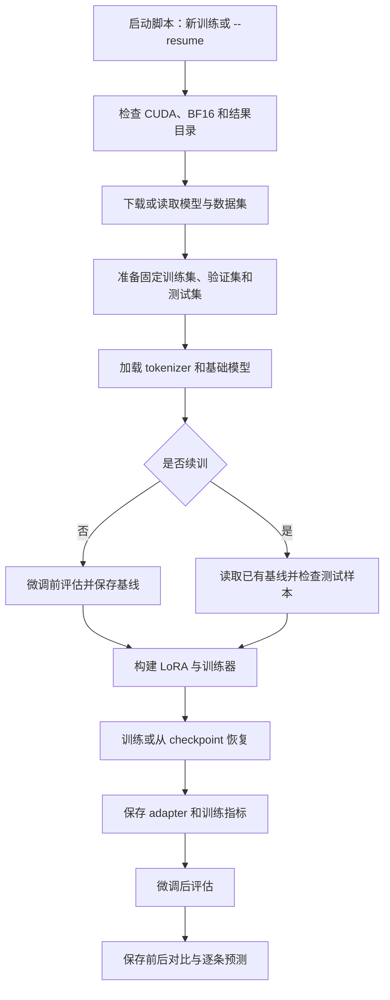

# Gemma 4 CUDA LoRA 训练流程

对应脚本：[cuda_254_gemma4.py](cuda_254_gemma4.py)。

结果默认保存在 `/root/tmp/result`，该目录位于临时空间；需要留存的产物应在实例结束前备份。

## CPU 试跑记录（2026-10-29）

- ModelScope CPU 实例（8 核、约 28 GiB 内存），基础模型 BF16，LoRA 小样本（训练 16 条、测试 8 条）完成 4 步，训练调用约 5 分钟；该样本不足以评价微调效果。
- 完整实验观察时：训练前 400 条测试已完成，训练 25/1000 步，正在进行第一次 400 条周期验证；进程累计约 1 小时 23 分钟，其中 25 步约 26 分钟，周期验证至 342/400 条约 27 分钟。实验当时尚未完成。
- CPU 的 batch size 为 1、梯度累积为 4，每步处理 4 条；此前 [ModelScope MI300X 记录](../../platforms/amd_developer/notebook_ROCm/257-gemma4-e4b-emotion-lora.md)的 batch size 为 4、梯度累积为 4，每步处理 16 条，250 步训练调用约 18 分 36 秒（含周期验证和保存，不含独立前后测试）。两者不能直接按步比较。
- CPU 完整运行日志与产物在实例工作区 `/mnt/workspace/gemma4-cpu-bf16-full.log` 和 `/mnt/workspace/artifacts/gemma4-cpu-bf16-full/`；退出后 `process_resource_usage.json` 记录进程最大常驻内存，实例中断或强制终止时文件可能无法写出。
