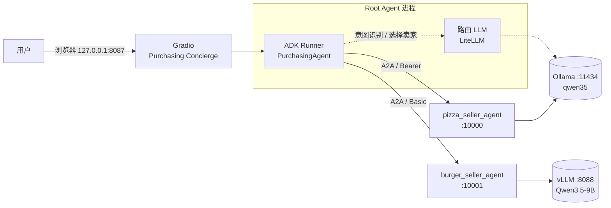
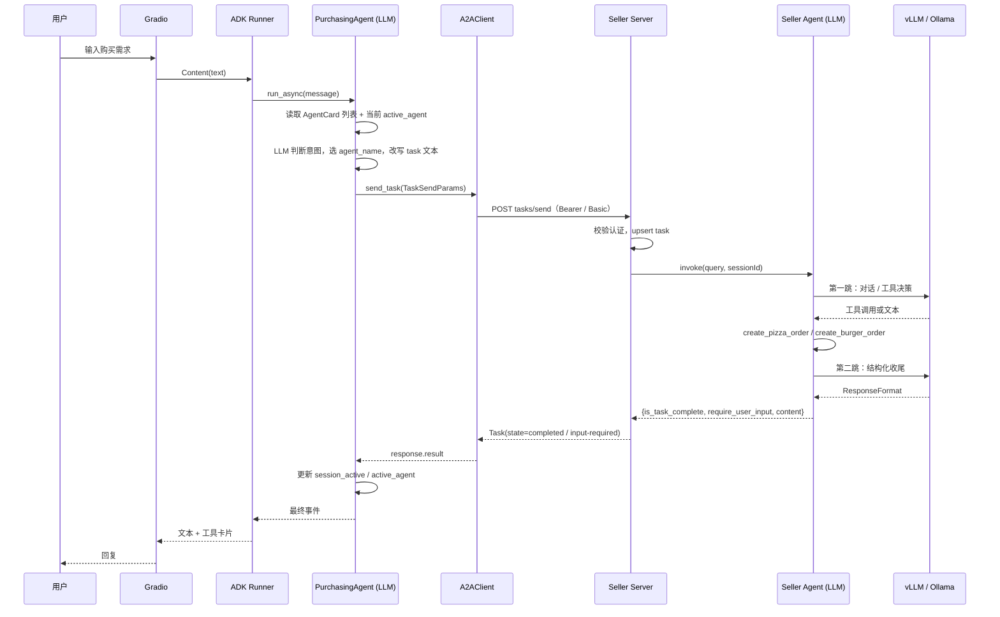

# 5061 Agents 201：基于 Google A2A 的多智能体点餐系统

- 模板：[Radeon Cloud 5061：Agents 201](https://developer.amd.com.cn/radeon/templates/5061/preview)
- 学习日期：2026-11-02
- 关联课程：AI 智能体（进阶篇：A2A 协议、多智能体协作）
- 运行环境：AMD Radeon Cloud 实例，vLLM + Ollama + Gradio
- 状态：核心链路已跑通（菜单查询、下单、多轮确认）

本文分两部分：**逻辑架构**说明系统由哪些角色组成、一次请求如何在它们之间流动；**具体实现**记录本次实际运行所用的模型、端口、配置与踩过的坑。

---

## 一、逻辑架构

### 1.1 总体拓扑

系统以一个 **Root Agent（Purchasing Concierge）** 为统一入口，向下编排两个独立的卖家 Agent。三个 Agent 之间只通过 **A2A 协议**通信，彼此不共享代码、不共享模型、也不共享进程。



图中的虚线是 Root Agent 自己的推理依赖：它需要一次 LLM 调用来判断该找哪个卖家。它和两条 A2A 实线不是同一类关系，也不占用 A2A 端口。披萨和 Root 共用同一个 Ollama 服务与模型，只是客户端不同（`ChatOllama` 与 LiteLLM）。

分工：

| 层 | 组件 | 职责 | 是否调用模型 |
|---|---|---|---|
| 交互层 | Gradio ChatInterface | 收发消息、展示工具调用与结果 | 否 |
| 编排层 | PurchasingAgent（ADK） | 意图识别、选择卖家、改写任务、汇总回复 | 是 |
| 协议层 | `utils/`（server / client / task_manager） | AgentCard 发现、JSON-RPC、任务状态、认证 | **否** |
| 执行层 | pizza / burger Seller Agent | 菜单问答、确认、调用下单工具 | 是 |

> 容易误解的一点：**A2A 协议本身不含模型调用**。`utils/` 里只有 HTTP、JSON-RPC 和认证逻辑；模型全部在各 Agent 的 `invoke()` 内部。协议层不知道、也不关心对面用的是 LangGraph 还是 CrewAI、Ollama 还是 vLLM。

### 1.2 一次请求的完整链路



### 1.3 Root Agent：意图识别与分工

Root Agent 不靠关键词匹配，而是靠 **LLM + AgentCard 列表**做路由：

1. **启动时发现卖家**：`PurchasingAgent.__init__` 对每个卖家地址调用 `A2ACardResolver.get_agent_card()`，把卡片（名字、描述、能力、认证方式）存进 `self.cards`，并序列化成一段 JSON 放进系统提示。
2. **接收用户消息**：ADK Runner 把消息交给 `PurchasingAgent` 背后的 LLM（LiteLLM → Ollama）。
3. **意图识别与选择**：系统提示里列出了所有可用 Agent 及其描述，LLM 据此判断该找披萨还是汉堡卖家；混合需求会拆成多次 `send_task`。
4. **改写任务**：LLM 把用户原话改写成卖家能独立理解的 `task` 文本。这一步很关键——卖家 Agent 看不到 root 的对话历史。
5. **发起 A2A 调用**：`send_task(agent_name, task, tool_context)` 组装 `TaskSendParams`，写入 `sessionId`、`taskId` 和 `conversation_id/message_id` 元数据。
6. **处理返回**：
   - `COMPLETED` → 清空 `active_agent`，把卖家的 artifact 原样转述给用户；
   - `INPUT_REQUIRED` → 保留 `active_agent`，并设置 `tool_context.actions.escalate = True`，让 ADK 把卖家的追问直接作为本轮最终回复；
   - 多轮场景下，`active_agent` 会让后续消息继续发给同一个卖家。

系统提示里还有几条约束：不要向用户征求“是否联系卖家”的许可、不要把披萨的上下文传给汉堡卖家、卖家反复要求确认时要把完整信息补进任务描述。

### 1.4 子 Agent：统一结构与两种实现

两个卖家 Agent 的骨架完全一致：

```text
┌─────────────────────────────────────────────┐
│  Pydantic 模型                               │
│    ResponseFormat / OrderItem / Order        │
├─────────────────────────────────────────────┤
│  工具函数                                    │
│    @tool create_pizza_order(order_items)     │
│    @tool("create_burger_order")              │
├─────────────────────────────────────────────┤
│  SellerAgent 类                              │
│    SYSTEM_INSTRUCTION：菜单、价格、确认规则   │
│    invoke(query, sessionId)                  │
│    get_agent_response(...)                   │
├─────────────────────────────────────────────┤
│  A2AServer 包装                              │
│    AgentCard（名称/URL/认证/技能）            │
│    AgentTaskManager                          │
└─────────────────────────────────────────────┘
```

`get_agent_response()` 把各家框架的输出归一化成同一个字典：

```python
{"is_task_complete": bool, "require_user_input": bool, "content": str}
```

`AgentTaskManager._process_agent_response()` 再据此映射 A2A 状态：

| 卖家返回 | A2A TaskState | 内容位置 |
|---|---|---|
| `require_user_input=True` | `input-required` | `status.message` |
| `require_user_input=False` | `completed` | `artifacts[0]` |
| 执行异常 | `error` 分支同样置 `require_user_input=True` | `status.message` |

两种实现的差异：

| | 披萨（LangGraph） | 汉堡（CrewAI） |
|---|---|---|
| 构图方式 | `create_agent(model, tools, checkpointer)` | 每次 `invoke` 新建 `Agent` + `Task` + `Crew` |
| 记忆 | `MemorySaver`，`sessionId` 作为 `thread_id` | 无记忆，靠 root 在 `task` 里补全上下文 |
| 结构化输出 | `with_structured_output(ResponseFormat)` | `output_pydantic=ResponseFormat` |
| 模型 | Ollama `qwen35` | vLLM `qwen35` |

无论哪种实现，**下单动作都发生在工具函数里**：生成 `order_id`、拼 `Order`、打印日志。目前订单只存在于日志和返回值中，没有落库。

### 1.5 A2A 协议层

`utils/` 实现的是协议本身，与模型无关：

| 文件 | 作用 |
|---|---|
| `a2a_types.py` | AgentCard、Task、Message、TextPart、TaskState 等 Pydantic 模型 |
| `card_resolver.py` | `GET /.well-known/agent.json` 获取卖家能力声明 |
| `client.py` | 组装 JSON-RPC，注入 Bearer/Basic 认证头 |
| `server.py` | Starlette 路由、认证校验、异常转 JSON-RPC error |
| `task_manager.py` | 任务存储与状态流转、调用 `agent.invoke()` |
| `task_manager_base.py` | 内存任务表（按 `taskId` 存取） |

核心约束：协议只认 `invoke(query, sessionId)` 这两个字符串，模型、框架、语言全部被挡在这个接口后面。

---

## 二、具体实现（本次运行）

### 2.1 运行拓扑

| 服务 | 端口 | 框架 | 模型 | 认证 |
|---|---|---|---|---|
| Gradio Concierge | 8087 | Gradio 6 + ADK 1.19 | Ollama `qwen35`（经 LiteLLM） | — |
| pizza_seller_agent | 10000 | LangGraph 1.2 | Ollama `qwen35` | Bearer |
| burger_seller_agent | 10001 | CrewAI 1.6 | vLLM `qwen35` | Basic |
| vLLM | 8088 | vLLM | Qwen3.5-9B | — |
| Ollama | 11434 | Ollama | `qwen35:latest`（约 5.7 GB） | — |

`qwen35` 是本地注册的模型别名；vLLM 侧实际服务的是 Qwen3.5-9B。

### 2.2 目录结构

```text
/workspace/agents_201/
├── 5061_agent_pizza.py        # 披萨卖家 + A2A Server
├── 5061_agent_burger.py       # 汉堡卖家 + A2A Server
├── 5061_agent_root.py         # 编排器 + Gradio
├── run_agents.sh              # 启停脚本（nohup，替代 tmux）
├── .env                       # 地址、端口、认证、模型名
├── requirements-lock.txt      # 230 个包的冻结版本
├── logs/                      # 三个服务的运行日志
└── utils/                     # A2A 协议实现
```

### 2.3 配置

所有可变项集中在 `/workspace/agents_201/.env`，三个脚本用 `python-dotenv` 读取：

```ini
OLLAMA_BASE_URL=http://localhost:11434
OLLAMA_MODEL=qwen35
OLLAMA_CHAT_MODEL=ollama_chat/qwen35
VLLM_BASE_URL=http://localhost:8088/v1
VLLM_MODEL=qwen35

PIZZA_AGENT_HOST=0.0.0.0
PIZZA_AGENT_PORT=10000
PIZZA_AGENT_URL=http://localhost:10000
PIZZA_AGENT_AUTH=<demo-token>

BURGER_AGENT_HOST=0.0.0.0
BURGER_AGENT_PORT=10001
BURGER_AGENT_URL=http://localhost:10001
BURGER_AGENT_USER=<demo-user>
BURGER_AGENT_PASSWORD=<demo-password>

CONCIERGE_HOST=0.0.0.0
CONCIERGE_PORT=8087
```

认证值沿用教程的演示凭据，仅用于本地实例；`.env` 权限设为 `600`，不提交到仓库。

Ollama 的模型名在 LiteLLM 侧必须带 `ollama_chat/` 前缀（`ollama/` 走的是另一套接口），这是之前踩过的坑。

### 2.4 启停

```bash
cd /workspace/agents_201
bash run_agents.sh start|stop|restart|status [pizza|burger|concierge|sellers|all]
```

脚本用 `setsid nohup python -u ... > logs/<name>.log 2>&1 &` 启动，进程脱离终端（`PPID=1`、无 tty），因此：

- 看日志用 `tail -f logs/*.log`，不能用 `tmux attach`；
- `Ctrl-C` 不再生效，停服务用 `run_agents.sh stop`。

**启动顺序有依赖**：concierge 在启动时就要拉取两张 AgentCard，必须等两个卖家端口就绪后再起，否则它的 `remote_agent_connections` 会缺一个卖家。`run_agents.sh restart all` 里用 `wait_port` 处理了这个顺序。

### 2.5 本地访问：SSH 隧道

平台的 sshd 默认 `AllowTcpForwarding no`，直接 `ssh -L` 会报 `administratively prohibited`。解法：

```bash
# 实例上执行一次，放开端口转发
/workspace/enable-ssh-forward.sh

# 本地建立隧道
ssh -N -L 8087:127.0.0.1:8087 radeon-gpu

# 浏览器访问
http://127.0.0.1:8087
```

隧道只转发 8087；pizza/burger 的 10000/10001 不需要暴露给浏览器，root 在实例内部通过 `localhost` 访问它们。

### 2.6 验证方法

```bash
# 1. 卖家能力声明
curl -s http://localhost:10000/.well-known/agent.json | jq .name,.authentication.schemes
curl -s http://localhost:10001/.well-known/agent.json | jq .name,.authentication.schemes

# 2. 编排器是否发现两张卡
grep "Found agent card" /workspace/agents_201/logs/concierge.log

# 3. 端到端（Gradio API 入口为 /get_response_from_agent）
python -c "
from gradio_client import Client
c = Client('http://127.0.0.1:8087', verbose=False)
print(c.predict('What burgers do you have?', api_name='/get_response_from_agent'))
"
```

本次实测：两张卡片均被发现；菜单查询经 concierge → burger 正常返回；下单请求在 burger 日志中留下 `order created: order_id=...`，并通过 `artifact` 回传给 UI。

### 2.7 多轮确认

披萨侧使用 LangGraph 的 `thread_id` 保存会话，因此可以完成“先问价、再确认”的两轮交互：

1. 用户表达购买意向 → 卖家返回 `input-required`，追问是否确认总价；
2. root 收到 `INPUT_REQUIRED` 后 `escalate=True`，把问题抛给用户，同时保留 `active_agent`；
3. 用户回复“确认” → root 继续发给同一个卖家，`sessionId` 不变，LangGraph 命中同一线程；
4. 卖家调用工具、返回 `completed`，root 清空 `active_agent`。

汉堡侧 CrewAI 每次 `invoke` 都新建 Crew，没有跨轮记忆，所以确认信息必须在 root 改写 `task` 时一次性给全。

### 2.8 已知问题与修复记录

| 问题 | 现象 | 处理 |
|---|---|---|
| 包版本互斥 | `langchain==1.1.0` 要求 `langgraph<1.1.0`，但 `langgraph-prebuilt` 需要 `ExecutionInfo` | 固定为 langchain 1.4.7 / langgraph 1.2.19 / prebuilt 1.1.1 / checkpoint 4.3.1 |
| 改包后旧模块残留 | `signature_no_eval`、`get_coro_name` 等报错 | 装完包必须重启 Jupyter kernel 和所有服务进程 |
| venv 在 overlay | 实例重启即丢（`/root/tmp/agents-201/.venv`） | 保留 `requirements-lock.txt`，重建时按锁文件安装；不要把 venv 放 NFS |
| Ollama 模型名 | LiteLLM 无法识别 | 使用 `ollama_chat/qwen35` |
| CrewAI 收尾空响应 | `completion_tokens=1` → `Invalid response from LLM call`，随后**整条 crew 重跑**，同一需求生成两个 `order_id` | 待修：给工具加幂等键，或在 `kickoff` 外层捕获空响应做确定性兜底 |
| CrewAI telemetry | 每次调用打印 proxy 403 | 不影响功能，可关闭 telemetry 消除噪音 |
| 日志“不刷新” | 重定向到文件后日志长时间为空 | Python 非 tty 时启用缓冲，启动加 `-u` |
| 同步调用阻塞事件循环 | 卖家处理期间 A2A 服务无法响应其他请求 | `on_send_task` 直接调用同步 `agent.invoke()`；多请求场景应放入线程池 |

### 2.9 与课程知识的对应

- **A2A 的价值不在协议复杂度**，而在于把“模型 + 框架”差异挡在 `invoke(query, sessionId)` 后面：本例中 LangGraph 与 CrewAI 可以互换，Ollama 与 vLLM 也可以互换。
- **AgentCard 是运行时发现机制**，不是静态配置；root 启动时读卡，因此新增卖家只需多传一个地址。
- **多智能体的难点在上下文边界**：卖家看不到 root 的历史，root 必须把“用户意图 + 已确认信息”改写成自包含的任务描述。
- **协议层与模型层要分开看**：排查问题时先确认是 A2A（卡片、认证、状态）还是模型（空响应、格式错误），两者的修复路径完全不同。

---

## 下一步

1. 修复 CrewAI 重试导致的重复下单（幂等键 + 空响应兜底）。
2. 将卖家处理移入线程池，避免单请求阻塞整个 A2A 服务。
3. 订单落库（当前仅打印日志），便于验证幂等与对账。
